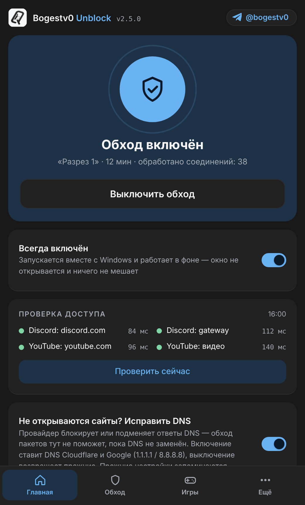
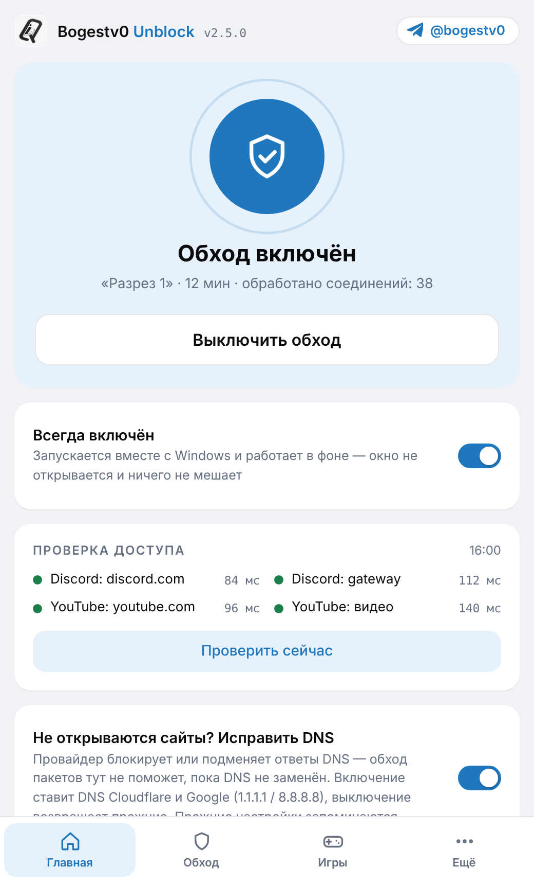
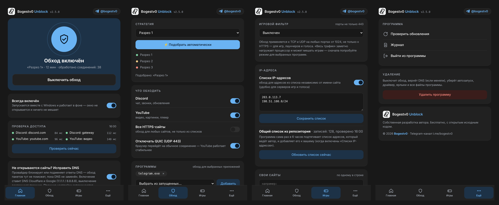
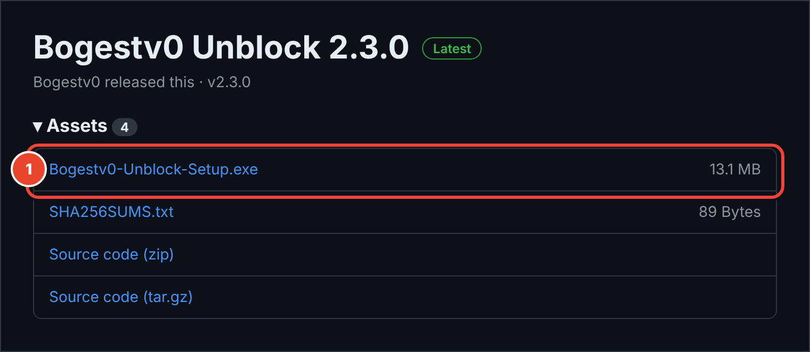
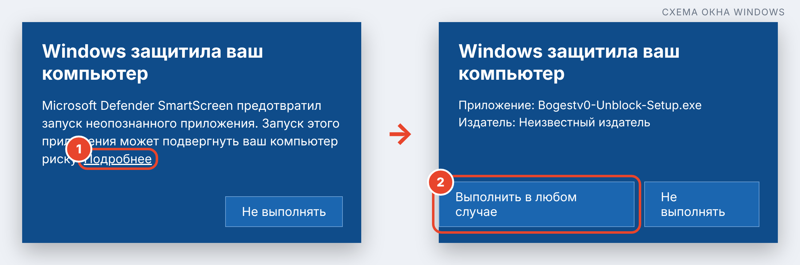
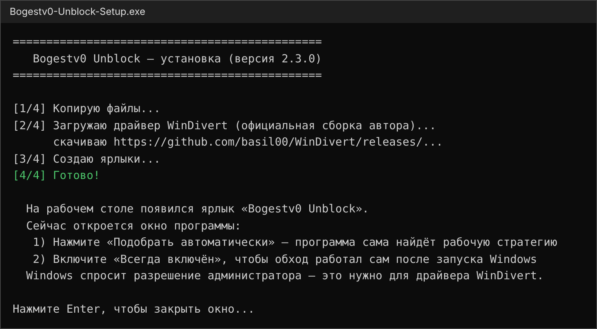
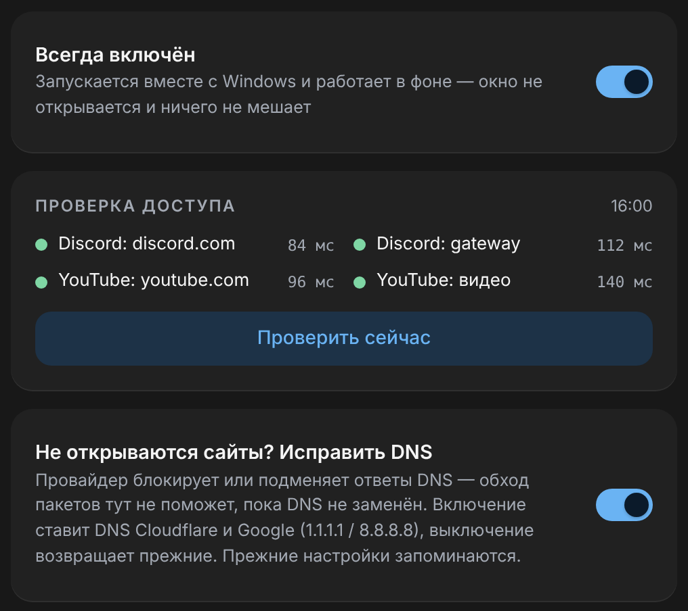
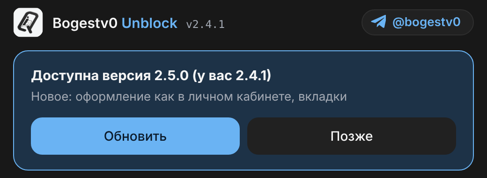

# Bogestv0 Unblock

Программа для Windows, которая помогает открыть **Discord**, **YouTube** (а при желании — игры и другие сайты и программы), если провайдер их замедляет или блокирует. Бесплатная, с открытым исходным кодом, весь код написан автором.

 

Автор и разработчик: **Bogestv0** · Telegram-канал **[@bogestv0](https://t.me/bogestv0)** · © 2026 Bogestv0

Окно состоит из четырёх вкладок — «Главная», «Обход», «Игры и сайты» и «Ещё». Оформление совпадает с личным кабинетом и сам подстраивается под светлую или тёмную тему Windows.



---

## Что нового

### 2.5.0 — новое оформление и навигация
* **Единый стиль с личным кабинетом.** Те же цвета (синий акцент вместо зелёного), шрифты, скругления и карточки — программа и кабинет теперь выглядят как одно целое.
* **Светлая и тёмная тема.** Окно само берёт тему из настроек Windows (раньше было только тёмное).
* **Вкладки вместо длинной ленты.** Всё разложено по разделам: «Главная» (включить обход, проверка доступа, DNS), «Обход» (стратегия, что обходить, программы), «Игры и сайты» (игровой фильтр, IP-адреса, свои сайты), «Ещё» (обновления, журнал, выход, удаление). Внизу — панель вкладок, как в мобильной версии кабинета; в широком окне — боковое меню.
* **Запоминается последняя открытая вкладка.**
* **Новые переключатели, кнопки и индикаторы** в стиле кабинета; ошибки подсвечиваются красным, успех — зелёным.
* В разделе «Ещё» появилась карточка об авторе.
* Все скриншоты в этой инструкции обновлены. Работа обхода и настройки не менялись — всё, что вы настроили раньше, сохраняется.

Предыдущие версии: [все релизы](../../releases).

---

## Чем «Обход» отличается от «VPN»

У автора две отдельные программы. Они решают похожую задачу по-разному и **не зависят друг от друга** — ставить можно одну или обе.

| | **Bogestv0 Unblock** (эта программа, «обход») | **Bogestv0 VPN** |
|---|---|---|
| **Как работает** | Меняет способ отправки первого пакета соединения, чтобы оборудование провайдера не опознало сайт. Трафик идёт **напрямую**, без чужого сервера | Направляет трафик через **ваш VPN-сервер** (VLESS/Reality, движок xray-core) |
| **Что нужно** | Только сама программа | Свой VPN-сервер и ссылка на него |
| **Что охватывает** | Всё приложение целиком: Discord (чат и голос), YouTube, при желании игры и другие программы | Только браузер: расширение направляет на VPN трафик браузера |
| **Скорость** | Как обычно — трафик не делает крюк через сервер | Зависит от сервера и канала до него |
| **Права администратора** | Нужны (драйвер WinDivert) | Не нужны (кроме кнопки «Исправить DNS») |
| **Когда выбирать** | Сайт открывается, но медленно, или блокировка по имени сайта (Discord, YouTube) | Обход не помогает: заблокирован сам адрес сервера, либо нужен другой «внешний» IP |
| **Где хранит файлы** | `%LOCALAPPDATA%\Bogestv0Unblock` | `%LOCALAPPDATA%\Bogestv0VPN` |

**Общее:** обе программы умеют «Исправить DNS» и ставят одни и те же адреса (1.1.1.1 / 8.8.8.8). Поэтому **удаление обхода не сбрасывает DNS, если им уже пользуется VPN** — настройка VPN остаётся нетронутой. Чтобы вернуть DNS в таком случае, используйте кнопку «Вернуть как было» в самом VPN.

---

## Это безопасно? Простыми словами

Частый вопрос: «а это не вирус и не майнер?» Ответ — нет, и вот почему.

| Что | Ответ |
|---|---|
| **Майнер криптовалют?** | **Нет.** В программе нет ничего, что считает или «добывает». Она почти ничего не потребляет: просто чуть меняет способ отправки ваших же пакетов в интернет |
| **Вирус, шпион, кража паролей?** | **Нет.** Программа не читает ваши пароли, переписки, страницы сайтов и файлы. Она видит только «служебное начало» соединения (адрес сайта, к которому вы обращаетесь) — и только затем, чтобы решить, применять ли обход |
| **Отправляет ли куда-то ваши данные?** | **Нет.** Ни статистики, ни рекламы, ни «телеметрии». Единственные обращения в интернет перечислены ниже |
| **Проксирует или шифрует трафик через чужой сервер?** | **Нет.** Это не VPN: ваш трафик идёт напрямую к сайту, просто в «упаковке», которую оборудование провайдера не умеет блокировать |
| **Показывает рекламу, ставит что-то лишнее?** | **Нет** |
| **Открытый код?** | **Да.** Весь код лежит в этом репозитории — его можно прочитать и собрать самому (раздел «Для разработчиков»). Готовый установщик собирает GitHub автоматически из этого же кода |

### К каким адресам программа обращается сама
| Куда | Зачем | Можно ли отключить |
|---|---|---|
| `github.com`, `api.github.com`, `raw.githubusercontent.com` | Проверить, не вышла ли новая версия, и подтянуть общий список IP-адресов | Если не нажимать «Обновить», ничего не ставится. Без интернета программа просто работает как раньше |
| Discord и YouTube (`discord.com`, `youtube.com`, `i.ytimg.com` и т. п.) | Кнопка «Проверка доступа» — открывается ли сайт. Это обычный запрос главной страницы, как в браузере | Это и есть проверка; личных данных не передаётся |
| Официальная страница драйвера WinDivert на GitHub | Только **при установке**: скачать драйвер | Можно положить архив рядом с установщиком — тогда ничего не скачивается |
| `t.me/bogestv0` | Только **если вы нажмёте** кнопку Telegram в окне | — |

### Почему нужны права администратора и почему антивирус может ругаться
Чтобы изменить пакеты на пути в интернет, нужен специальный драйвер — **[WinDivert](https://github.com/basil00/WinDivert)** (известная открытая библиотека, её используют многие сетевые программы). Драйверы Windows ставятся только с правами администратора — поэтому Windows спросит подтверждение.

Из-за того, что WinDivert умеет перехватывать пакеты, **некоторые антивирусы относятся к нему с подозрением** (это «потенциально нежелательное», а не вирус). Установщик также не подписан платным сертификатом, поэтому Windows SmartScreen покажет синее окно. Это обычная история для небольших бесплатных программ.

### Как проверить самому
* **Контрольная сумма.** Рядом с установщиком в Releases лежит `SHA256SUMS.txt`. В PowerShell: `Get-FileHash .\Bogestv0-Unblock-Setup.exe -Algorithm SHA256` — значение должно совпасть.
* **VirusTotal.** Загрузите установщик на [virustotal.com](https://www.virustotal.com) и посмотрите, что скажут десятки антивирусов (единичные «подозрения» на WinDivert возможны).
* **Код.** Каталог `app/` — программа, `installer/` — установщик. Читать можно всё.

### Что именно оказывается на компьютере
| Что | Где | Зачем |
|---|---|---|
| Файлы программы | `%LOCALAPPDATA%\Bogestv0Unblock` (обычно `C:\Users\<имя>\AppData\Local\Bogestv0Unblock`) | Сама программа, драйвер, настройки, ваши списки |
| Ярлыки | Рабочий стол и меню «Пуск» | Открыть окно |
| Запись в «Приложения» | Параметры → Приложения | Чтобы можно было удалить обычным способом |
| Задача «Bogestv0Unblock» в планировщике | Только если включён переключатель **«Всегда включён»** | Запускать обход вместе с Windows |
| Драйвер WinDivert | Загружается только пока обход включён, при выключении выгружается | Перехват пакетов |
| Смена DNS | Только если вы сами включили переключатель «Исправить DNS» | См. ниже |

**Ничего не вносится в систему скрытно:** нет автозапуска без вашего согласия, нет фоновых служб «навсегда», нет изменения файла `hosts`, нет сторонних программ. Удаление убирает всё перечисленное (раздел «Удаление»).

---

## Установка (Windows) — пошагово с картинками

### Что понадобится
* Windows 10 / 11 (64-бит)
* Права администратора (программа сама попросит подтверждение)
* Интернет при установке (скачивается драйвер WinDivert)

### Шаг 1. Скачайте установщик
Откройте **[Releases](../../releases/latest)** и в списке **Assets** нажмите на файл **`Bogestv0-Unblock-Setup.exe`** (на картинке — цифра 1). Он сохранится в «Загрузки».



### Шаг 2. Запустите его
Дважды щёлкните по файлу. Если Windows покажет синее окно **«Windows защитила ваш компьютер»** (так бывает с любыми программами без платной подписи — это не значит, что файл опасный):
1. Нажмите **«Подробнее»**.
2. Нажмите **«Выполнить в любом случае»**.
3. Разрешите запрос администратора («Да»).



### Шаг 3. Дождитесь окончания
Откроется чёрное окно, установка занимает около минуты. В конце — надпись **«Готово!»**, ярлык на рабочем столе, и окно программы откроется само.



### Шаг 4. Подберите способ обхода
Откройте вкладку **«Обход»** и нажмите **«⚡ Подобрать автоматически»**. Программа сама перепробует свои способы и выберет тот, при котором Discord и YouTube открываются **именно у вашего провайдера** (у разных провайдеров работает разное). Около минуты. После подбора обход уже включён.

Если в «Проверке доступа» написано **«DNS: имя не найдено»** — включите переключатель **«Не открываются сайты? Исправить DNS»** и повторите подбор.

### Шаг 5 (по желанию). Включите «Всегда включён»
На вкладке **«Главная»** включите переключатель. Тогда обход сам запускается вместе с Windows **в фоне, без окна**. Окно можно открыть ярлыком в любой момент.



---

## Что за что отвечает и что будет, если включить или выключить

Ничего из этого не опасно и не необратимо — любой переключатель можно вернуть обратно в один клик.

### Вкладка «Главная»
| Элемент | Что делает | Если выключить |
|---|---|---|
| **Включить / Выключить обход** (большая кнопка) | Запускает и останавливает обход | Программа ничего не делает, интернет работает как будто её нет. Драйвер выгружается |
| **Всегда включён** | Обход запускается сам при старте Windows, в фоне, без окна | Обход включается только когда вы нажмёте кнопку. Закрытие окна обход **не выключает** в любом случае |
| **Проверка доступа** | Пробует открыть Discord и YouTube и показывает, что работает (зелёный) и что нет (красный) | Просто нет подсказки — на работу не влияет |
| **Подобрать автоматически** (вкладка «Обход») | Пробует по очереди способы обхода и выбирает рабочий | Можно выбрать способ вручную в списке «Стратегия» |
| **Стратегия** (список, вкладка «Обход») | Способ, которым программа «упаковывает» соединение. Чем отличаются — не важно: нужная у вас найдётся автоподбором | — |

### «Не открываются сайты? Исправить DNS»
**DNS** — это «телефонная книга» интернета: превращает адрес `youtube.com` в числа. Некоторые провайдеры подделывают или блокируют ответы этой «книги» — тогда сайт не открывается вообще, и никакой обход не поможет, пока она не заменена.
* **Включить:** программа ставит DNS Cloudflare и Google (`1.1.1.1`, `8.8.8.8`). Ваши прежние настройки **запоминаются**.
* **Выключить:** прежние настройки возвращаются как были.
* Если не включать: DNS остаётся таким, какой был у вас — программа его не трогает.

### Вкладка «Обход» → «Что обходить»
| Переключатель | Включено | Выключено |
|---|---|---|
| **Discord** | Обход работает для Discord | Discord не обрабатывается (если он у вас и так открывается — можно выключить) |
| **YouTube** | Обход работает для YouTube и его картинок/видео | То же для YouTube |
| **Все HTTPS-сайты** | Обход действует на любые сайты, не только из списков | Только Discord/YouTube, ваши сайты и программы. Включайте, если заблокировано что-то ещё |
| **Отключать QUIC** | Браузер перестаёт использовать «быстрый» протокол QUIC и переходит на обычный — через него обход работает надёжнее. Заметной разницы для вас не будет | QUIC работает как обычно; YouTube может грузиться хуже, если провайдер его режет |

### Вкладка «Обход» → «Программы»
Здесь можно выбрать приложения (например, браузер или Telegram), для которых обход действует **на все сайты и адреса** — не только Discord/YouTube. Выбирайте из списка запущенных или впишите имя файла (`telegram.exe`). Если список пуст — ничего не меняется.

### Вкладка «Игры и сайты» → «Игровой фильтр» и «IP-адреса»
| Элемент | Что делает | Если выключить |
|---|---|---|
| **Игровой фильтр → только выбранные программы** | Для программ из раздела «Программы» обход работает и на «игровых» портах, не только для сайтов | Игры не затрагиваются |
| **Игровой фильтр → весь трафик** | Обход действует на **весь** трафик с портами от 1024. Заметно нагружает процессор и может мешать играм — сначала пробуйте предыдущий режим | — |
| **Списки IP-адресов** | Обход применяется к адресам из списка (ваш + общий из репозитория), даже если имя сайта не видно | Адреса из списков не используются |
| **Обновить список сейчас** | Скачивает свежий общий список адресов с GitHub | Раз в 6 часов программа делает это сама |

> Вкладка «Игры и сайты» — для тех, у кого не работает голос или игры. Если у вас всё открывается, этот раздел можно не трогать.

### Вкладка «Игры и сайты» → «Свои сайты»
Впишите адреса сайтов (по одному в строке), для которых тоже нужен обход, и нажмите «Сохранить». Если пусто — ничего не меняется.

### Вкладка «Ещё» → «Удаление»
Красная кнопка. Первое нажатие просит подтверждения, второе — удаляет всё (см. ниже).

### Вкладка «Ещё» → «Программа»
| Элемент | Что делает |
|---|---|
| **Проверить обновления** | Узнаёт, вышла ли новая версия |
| **Журнал** | Показывает, что программа делала (для диагностики) |
| **Выйти из программы** | Полностью останавливает обход и закрывает программу. Ярлыком её можно запустить снова |
| **@bogestv0** (в шапке) и карточка автора | Открывают Telegram-канал автора |

---

## Обновления
Раз в 6 часов программа смотрит последний релиз на GitHub. Если вышла новая версия, сверху появится блок **«Доступна версия …»** с кнопками **«Обновить»** и **«Позже»**. «Обновить» скачивает установщик, **сверяет контрольную сумму** с `SHA256SUMS.txt` (если не совпала — обновление отменяется), ставит новую версию и снова открывает программу. Настройки и списки сохраняются. «Позже» просто прячет предложение — программа ничего не ставит без вашего нажатия.



---

## Закрыл окно — обход работает?
**Да.** Окно — это только «пульт управления», сам обход работает отдельно в фоне. Он остановится, только если вы нажмёте **«Выключить обход»** или **«Выйти из программы»**, либо перезагрузите компьютер (при включённом «Всегда включён» он сам запустится заново).

---

## Если что-то не работает

| Симптом | Что делать |
|---|---|
| «DNS: имя не найдено» в проверке | Включите переключатель «Исправить DNS». Если после этого имя всё равно не находится — провайдер перехватывает DNS-запросы: включите «Безопасный DNS» в браузере (Cloudflare) или DNS-over-HTTPS в Windows 11 |
| «Исправить DNS» пишет ошибку | Программа пробует два способа (PowerShell и `netsh`); в тексте ошибки видно, что именно не вышло. Пришлите его в [Telegram](https://t.me/bogestv0) |
| На ярлыке старая иконка | Иконка теперь вшита в сам `.exe`; установщик пересоздаёт ярлыки и сбрасывает кэш иконок. Если Windows всё же показывает старую — перезапустите Проводник (Диспетчер задач → Проводник → Перезапустить) |
| Автоподбор выбрал вариант, но YouTube не открывается | Подбор теперь требует, чтобы открывались **все** включённые сайты (в том числе `youtube.com` и «видео»), и пишет, что именно не открылось. Если полностью рабочего способа нет — проверьте DNS и повторите подбор |
| Все пункты красные, DNS в порядке | Нажмите «Подобрать автоматически». Если ни один способ не подошёл — пришлите скриншот окна и «Журнал» в [Telegram](https://t.me/bogestv0) |
| Установщик не смог скачать драйвер | Скачайте `WinDivert-2.2.x-A.zip` с [github.com/basil00/WinDivert/releases](https://github.com/basil00/WinDivert/releases) и положите **рядом с установщиком**, затем запустите его снова |
| Антивирус ругается на драйвер | Это штатная реакция на драйвер перехвата пакетов (см. выше). Если доверяете — добавьте папку `%LOCALAPPDATA%\Bogestv0Unblock` в исключения |
| Голос в Discord не работает, а чат работает | Попробуйте другие способы в списке «Стратегия»; голос автоматически проверить нельзя — проверяйте звонком. Можно также включить «Списки IP-адресов» на вкладке «Игры и сайты» |
| Сайты не открываются по IPv6 | Программа работает только с IPv4. Отключите IPv6 на сетевом адаптере |

## Удаление
Самый простой способ — раздел **«Ещё → Удаление»** в самой программе. Либо **Параметры → Приложения → Установленные приложения → Bogestv0 Unblock → Удалить**.

Удаляются: обход, файлы программы, драйвер WinDivert, ярлыки, автозапуск, запись в списке приложений. Если вы меняли DNS кнопкой — он возвращается к прежнему. Остаться могут только временные файлы скачанных обновлений в папке `%TEMP%` (папки `bogestv0-update-…`) — их Windows чистит сама, при желании удалите вручную.

## Честные ограничения
* Результат зависит от провайдера: единого способа нет — для этого есть автоподбор. Гарантировать, что сработает у каждого, нельзя.
* Только IPv4.
* Игровой фильтр и списки IP — новые функции: как поведут себя конкретные игры, зависит от игры и провайдера.
* Общий список IP собирается автоматически на серверах GitHub (в США): часть адресов у CDN может отличаться от ваших. Голосовые серверы Discord так найти нельзя.
* Установщик не подписан платным сертификатом — Windows покажет предупреждение SmartScreen.

---

## Для разработчиков

### Как это работает
Программа перехватывает **исходящие** пакеты и меняет способ отправки первого TLS-пакета (ClientHello), чтобы оборудование провайдера (DPI) не опознало имя сайта: разрезает пакет на части, отправляет их в обратном порядке, подмешивает «ложный» пакет с малым TTL или неверной контрольной суммой; для голоса Discord шлёт ложные UDP-пакеты; QUIC отбрасывает (браузер переходит на TCP). Трафик не проксируется и не шифруется. Окно управления — локальная страница на `127.0.0.1`, защищённая случайным ключом на каждый запуск.

### Сторонний компонент
[WinDivert](https://github.com/basil00/WinDivert) (LGPLv3 / GPLv2) — драйвер перехвата пакетов. В репозитории его нет: скачивается при установке с официальной страницы автора. Подробнее — `NOTICE.txt`.

### Структура
```
app/         программа: движок, окно (ui/index.html), проверка обновлений
installer/   установщик (Go): всё вшивается в один .exe
lists/       общий список IP (lists/ipset.txt): пополняется GitHub Actions, программы скачивают сами
tools/       make_syso.py — собирает иконку в ресурс .syso (app/ и installer/ → rsrc_windows_amd64.syso)
build.sh     сборка
```

Иконка лежит в `app/icon.ico`. После её замены выполните `python3 tools/make_syso.py app/icon.ico app/rsrc_windows_amd64.syso installer/rsrc_windows_amd64.syso` (нужен Pillow) и закоммитьте оба `.syso` — Go подхватит их при сборке.

### Сборка (нужен Go 1.21+)
```bash
./build.sh          # → dist/Bogestv0-Unblock-Setup.exe
```

---

**Bogestv0 Unblock** — собственная разработка автора Bogestv0. © 2026 Bogestv0 · [t.me/bogestv0](https://t.me/bogestv0)
